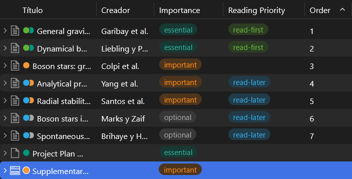

# Reading Priority for Zotero

A small Zotero Desktop add-on that displays sortable research reading-plan columns derived from existing item tags. It uses Zotero's ItemTreeManager API, without modifying bibliographic metadata or tags.

## Preview

*Actual Zotero Desktop screenshot in dark mode, sorted by Order. The optional automatic Priority column is not shown in this view.*

## Installation

Version 1.0.4 declares compatibility with Zotero 10.0.x. The plugin is intended for Zotero Desktop, not the web library.

1. Download [reading-priority-1.0.4.xpi](https://github.com/physedu/zotero-reading-priority/raw/refs/heads/main/reading-priority-1.0.4.xpi).
2. In Zotero, open Tools → Plugins, then the gear menu → Install Plugin From File.
3. Select the XPI and restart if needed.
4. Right-click the library table headers and enable the desired columns.

## Tags and columns

| Column | Source tags | Meaning |
| --- | --- | --- |
| Importance | `essential`, `important`, `optional` | Scientific importance |
| Reading Priority | `read-first`, `read-later` | Reading urgency |
| Order | `reading-order: 1`, `reading-order: 2`, etc. | Manual reading sequence |
| Priority | Calculated from importance and urgency | Automatic rank from 1 to 6 |

Priority ranks are: 1 = read-first + essential; 2 = read-first + important; 3 = read-first + optional; 4 = read-later + essential; 5 = read-later + important; 6 = read-later + optional. The value is blank when either required tag is missing. For conflicting tags the highest-priority value wins; for multiple order tags the lowest positive safe integer wins.

Importance and Reading Priority use colored rounded labels, using the native Zotero tag color when available, or built-in fallback colors. Order uses a colored label only if its tag has a native color. Priority remains neutral. The source adjusts foreground/background contrast for light and dark themes.

Tags are global to an item, not collection-specific; a paper shared by several projects has the same classification in each collection. The add-on itself is read-only. Updates are manual: the required manifest update URL is a reserved `.invalid` address and does not provide an update service.

## Build

Run `python build.py` from the repository root (Python 3, no dependencies). This packages the manifest, JavaScript and icons into an XPI.

## Compatibility and status

The manifest targets Zotero 10.0.x. Installation and the colored Importance and Reading Priority labels, along with the manual Order column, have been confirmed by the author on Zotero 10.0.8 (Windows x64), as shown in the screenshot above. The screenshot does not validate the automatic Priority column or light-mode rendering. No other Zotero versions have been validated.

API documentation: https://www.zotero.org/support/dev/zotero_7_for_developers#custom_item_tree_columns

This is an independent add-on, not an official Zotero product.

## License

[MIT](LICENSE).
